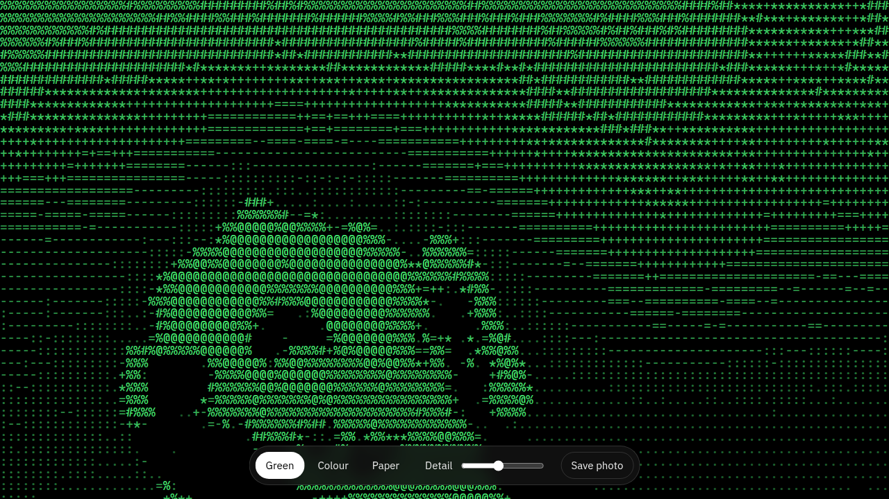

# asciicam

Shows your webcam as ASCII characters in the browser.

Hosted at https://salw2e.github.io/asciicam/, or open `index.html` locally. The camera image stays in the browser.

Green, colour and paper modes, a slider for how many characters wide the picture is, and a button to save the current frame as a PNG.
